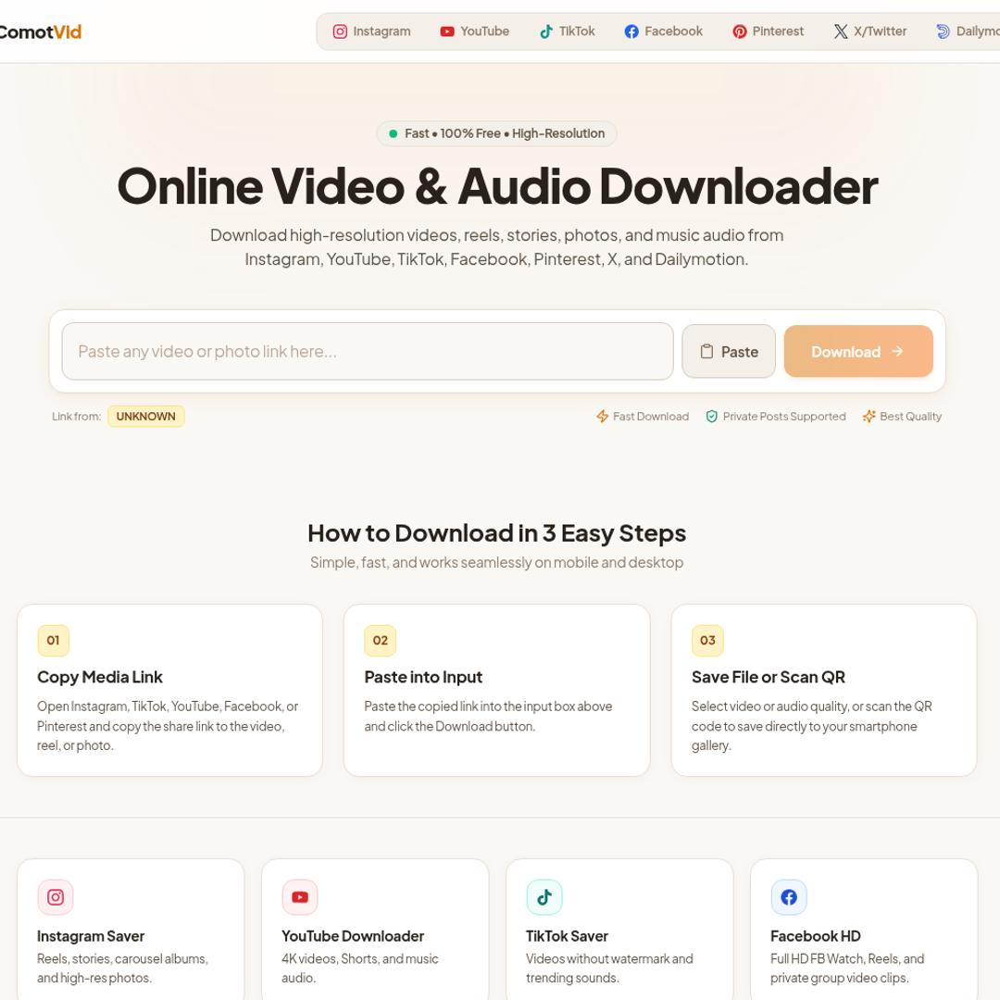
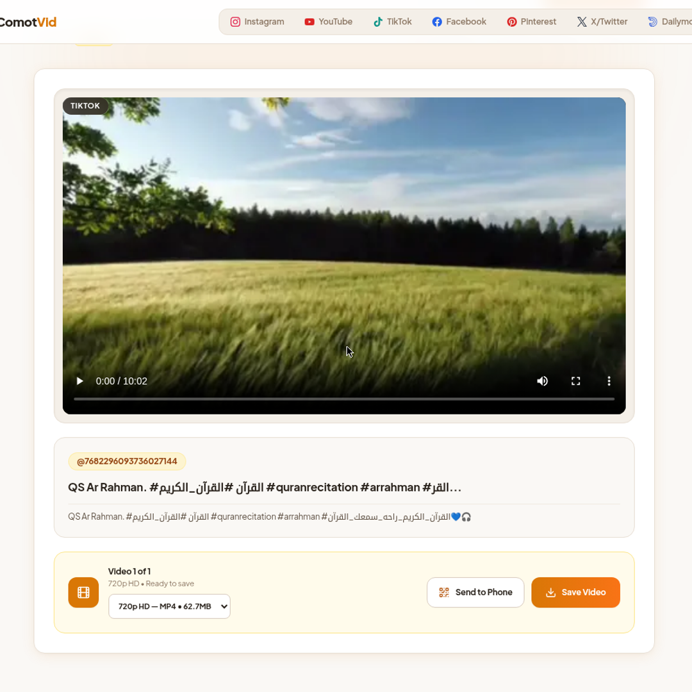

# ComotVid — Self-Hosted Video & Photo Downloader

Download videos, reels, stories, photos, and audio from **Instagram, YouTube, TikTok, Facebook, Pinterest, X (Twitter), and Dailymotion** — from your own server. Paste a link, pick a quality, save the original file. No ads, no pop-ups, no shady third-party downloader sites.

**Live demo:** https://comotvid.ukay.dev · **Get the full source:** https://digikarya.gumroad.com/l/comotvid-downloader



## Features

- **7 platforms, one interface** — all-in-one home plus a dedicated page per platform (Instagram, YouTube, TikTok, Facebook, Pinterest, X, Dailymotion)
- **Every available quality** — from 360p up to the source maximum, with automatic video + audio merging into a single MP4 (ffmpeg)
- **TikTok without watermark**, Instagram reels/stories/carousels in full resolution, YouTube 4K + Shorts + music audio
- **Photo posts & carousels** in a full-resolution gallery, including TikTok photo posts
- **Instagram private-post/story resolver flow**
- **Send-to-phone** short link + QR code for every result — scan and save straight to your phone gallery
- **Optional cookies support** for YouTube bot checks and TikTok age-gated posts
- **One-command Docker deploy** — no database needed, runs fine on a small VPS



## Self-host in 60 seconds

```bash
# 1. Get the source (one-time purchase, pay what you want from $29)
#    https://digikarya.gumroad.com/l/comotvid-downloader

# 2. Unzip and configure
unzip comotvid-downloader-v1.0.0.zip && cd comotvid-downloader
cp .env.example .env

# 3. Deploy
docker compose up -d --build
```

Manual install with Node.js 22+ is also supported — see the README inside the package.

A minimal `docker-compose.yml` for reference:

```yaml
services:
  comotvid:
    build: .
    ports:
      - "20229:20229"
    environment:
      - PORT=20229
      # optional: mount cookies for age-gated / bot-checked content
      # - ./.cookies:/app/.cookies:ro
    restart: unless-stopped
```

## Why self-host?

- **Privacy** — links you paste never touch a third-party downloader service
- **No ads, no pop-ups, no "Download" buttons that install malware**
- **No rate limits or queues** — it's your server
- **Full source code** — audit it, theme it, extend it

## Tech stack

Astro + React + Tailwind CSS, powered by [yt-dlp](https://github.com/yt-dlp/yt-dlp) and ffmpeg. No database.

## FAQ

**Is ComotVid free?**
The live demo is free to try. The full self-hostable source code is a one-time purchase (pay what you want, starting at $29) — that keeps the project independent, with no ads and no tracking.

**Which platforms are supported?**
Instagram, YouTube, TikTok, Facebook, Pinterest, X (Twitter), and Dailymotion — 7 in total.

**Do I need a powerful server?**
No. Any small VPS with Docker works; there is no database and idle RAM usage is modest.

**Can I use it commercially?**
The license covers personal use on your own domain. Please also respect each platform's Terms of Service and copyright law.

## License

This repository contains documentation and screenshots only. The ComotVid application source code is sold separately — see [Gumroad](https://digikarya.gumroad.com/l/comotvid-downloader) for license terms.
